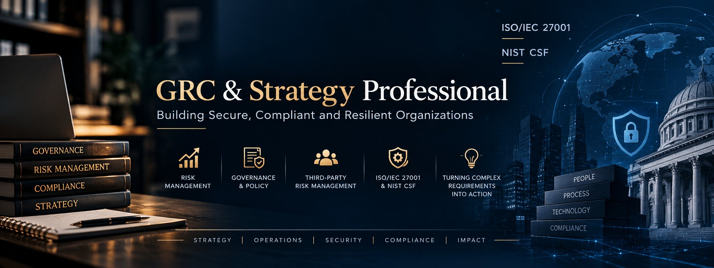
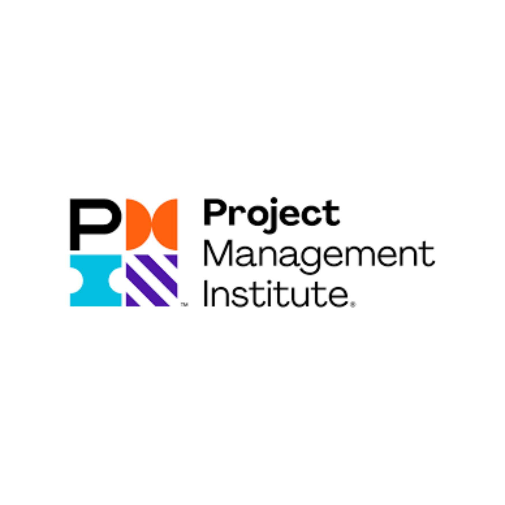
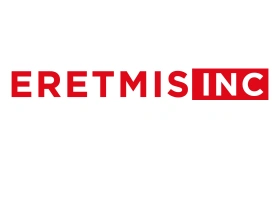
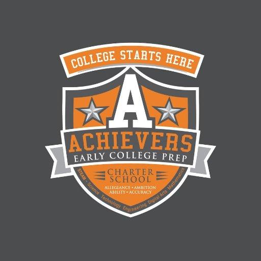
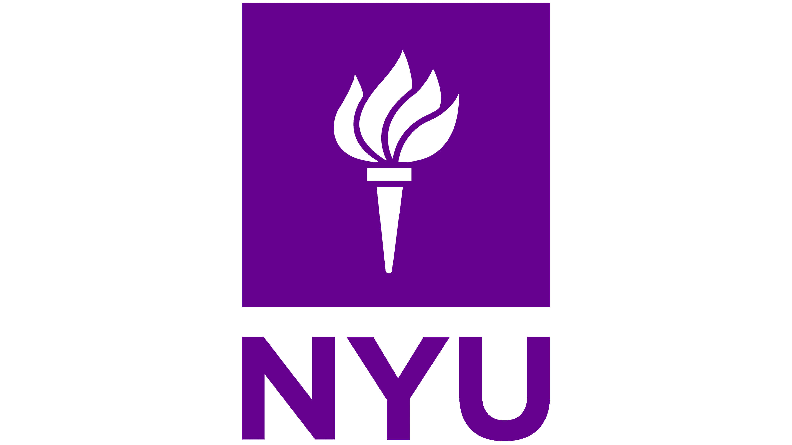
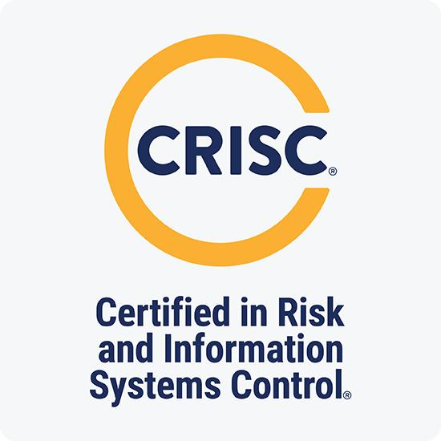
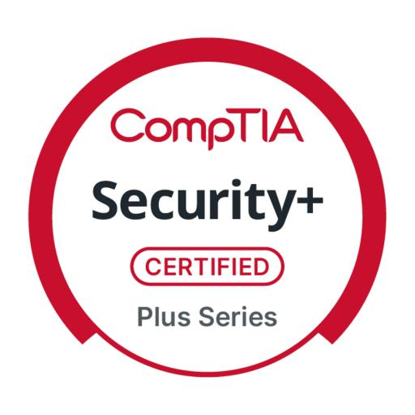

# Hi there 👋

  

  <a href="YOUR_LINKEDIN_URL">LinkedIn Profile</a> •
  <a href="mailto:YOUR_EMAIL">Email</a> •
  <a href="YOUR_RESUME_PATH">My Resume</a>

---

## 🚀 About Me

I’m a Governance, Risk & Compliance (GRC) and strategy professional with experience building governance frameworks, managing enterprise and third-party risk, and leading cross-functional initiatives from strategy through execution.

**I focus on:**

- Enterprise and project risk management
- Governance, policy development, and internal controls
- Third-Party Risk Management (TPRM)
- Aligning practices with ISO/IEC 27001 and NIST CSF
- Turning complex security and compliance requirements into clear, actionable work

I also have hands-on exposure across GRC, VAPT, and SOC workflows through a structured cybersecurity internship program, and I enjoy working where strategy, operations, and security intersect.

---

---

<h2>🏢 Organizations</h2>

  
  &nbsp;&nbsp;&nbsp;&nbsp;
  
  &nbsp;&nbsp;&nbsp;&nbsp;
  
  &nbsp;&nbsp;&nbsp;&nbsp;
  

<table>
<tr>
<th>Organization</th>
<th>Role</th>
<th>Mode</th>
<th>Duration</th>
</tr>

<tr>
<td>Project Management Institute</td>
<td>Risk Coordinator – Strategy & Governance</td>
<td>Remote</td>
<td>Nov 2025 – Present</td>
</tr>

<tr>
<td>Eretmis Inc.</td>
<td>GRC Analyst – Apprenticeship</td>
<td>Remote</td>
<td>Apr 2025 – Present</td>
</tr>

<tr>
<td>Achievers Early College Prep Charter School</td>
<td>Co-Founder & School Leader</td>
<td>On-site (Trenton, NJ)</td>
<td>Oct 2016 – Jun 2025</td>
</tr>

<tr>
<td>Logging Security Global</td>
<td>Cybersecurity Intern – GRC, VAPT & SOC</td>
<td>Remote</td>
<td>6-Week Program</td>
</tr>
</table>

---

---

<h2>🎓 Education</h2>

  
  &nbsp;&nbsp;&nbsp;&nbsp;&nbsp;
  

<table>
<tr>
<th>Institution</th>
<th>Qualification</th>
<th>Score</th>
</tr>

<tr>
<td>New York University</td>
<td>Master of Education / Master’s in Educational Leadership & Administration</td>
<td>GPA: 3.85</td>
</tr>

<tr>
<td>Rowan University</td>
<td>Bachelor of Science in Business Administration & Management</td>
<td>GPA: 3.61 / 3.80 (Cum Laude)</td>
</tr>
</table>

### 🏅 Honors & Activities

- Cum Laude Honorary
- Golden Key National Honor Society
- Mortar Board (Officer – Secretary)
- Chi Alpha Epsilon Honor Society

---

<h2>💼 Experience</h2>

### Risk Coordinator – Strategy & Governance

**Project Management Institute**

*Nov 2025 – Present | Washington DC–Baltimore Area (Remote)*

- Coordinate enterprise risk and governance activities, including risk assessments, compliance monitoring, audit readiness, and strategic risk reporting.
- Maintain risk registers, mitigation plans, and governance documentation to improve risk visibility and decision-making.
- Conduct policy inventories and gap analyses; draft and revise policies while coordinating stakeholder reviews.
- Support audit readiness and internal control activities by analyzing incidents, audit findings, and vendor feedback to drive remediation.
- Standardize policy templates and documentation processes to improve governance, version control, and organizational compliance.

---

### Governance, Risk & Compliance (GRC) Analyst – Apprenticeship

**Eretmis Inc.**

*Apr 2025 – Present | Remote*

- Manage GRC and Third-Party Risk Management (TPRM) initiatives across the full lifecycle, including planning, assessment, mitigation, reporting, and stakeholder communication.
- Coordinate with Legal, Procurement, IT, and Security to strengthen compliance and close control gaps.
- Develop and maintain risk registers, control frameworks, and documentation aligned with ISO/IEC 27001 and NIST CSF.
- Conduct policy reviews, compliance assessments, and training to support regulatory and organizational requirements.
- Support governance reporting and project tracking to improve accountability and operational transparency.

---

### Co-Founder & School Leader

**Achievers Early College Prep Charter School**

*Oct 2016 – Jun 2025 | Trenton, NJ*

- Co-founded and led strategic projects and organizational initiatives from planning through implementation.
- Directed operations, governance, compliance, budgeting, performance management, and strategic planning.
- Partnered with IT and technical teams to identify, assess, and mitigate cybersecurity, technology, and operational risks.
- Collaborated with technical teams on security controls, vulnerabilities, incidents, and remediation efforts.
- Led cross-functional teams through requirements gathering, risk assessment, change management, and project implementation.
- Developed policies, internal controls, risk registers, and reporting processes to strengthen governance and accountability.

---

<h2>🛡️ Cybersecurity Internship</h2>

  

### Logging Security Global

**Cybersecurity Internship – GRC, VAPT & SOC**

*6-Week Structured Program (Remote)*

**Focus Areas:** Governance, Risk & Compliance (GRC); Vulnerability Assessment & Penetration Testing (VAPT); Security Operations Center (SOC).

<strong>Week 1: Orientation & Cybersecurity Fundamentals</strong>

- Cybersecurity foundations, career pathways, and introduction to GRC, VAPT, and SOC.
- GitHub profile setup and professional development.

<strong>Week 2: GRC – Governance, Risk & Compliance</strong>

- Security policies and procedures, risk assessment, and risk registers.
- ISO 27001 fundamentals, security controls, compliance, audit documentation, and risk treatment.
- **Practical assignment:** Create a risk assessment report.

<strong>Week 3: VAPT – Vulnerability Assessment & Penetration Testing</strong>

- VAPT methodology, scope definition, OWASP Top 10, and web application security.
- Reconnaissance, scanning, vulnerability identification, CVSS scoring, and vulnerability reporting.
- **Practical assignment:** Assess an authorized practice lab and prepare a VAPT report.

<strong>Week 4: SOC – Security Operations Center</strong>

- SOC L1/L2 roles, incident response, SIEM fundamentals, and security log analysis.
- Threat hunting, suspicious activity detection, alert triage, incident documentation, and escalation.
- **Practical assignment:** Analyze sample logs and prepare an incident report.

<strong>Week 5: Integrated Security Project</strong>

- Guided project combining GRC, VAPT, and SOC concepts.
- Risk identification, vulnerability documentation, threat analysis, and recommendations.
- GitHub documentation and project presentation.

<strong>Week 6: Final Evaluation & Career Preparation</strong>

- Final project submission and presentation.
- Technical evaluation and feedback.
- Resume and LinkedIn profile improvement.
- Interview preparation and career guidance.
- Internship completion review and eligibility for completion documentation.

---

<h2>📜 Certifications</h2>

  
  &nbsp;&nbsp;&nbsp;&nbsp;
  

*Planned / in progress — update as earned.*

- CRISC – Certified in Risk and Information Systems Control
- ISO/IEC 27001 Lead Implementer / Lead Auditor
- CompTIA Security+

---

<h2>💼 Job Simulations</h2>

| Organization | Job Simulation | Platform | Date |
|---|---|---|---|
| Datacom | Cyber Security Operations Job Simulation | Forage | July 2026 |
| Deloitte Australia | Cyber Job Simulation | Forage | July 2026 |
| Goldman Sachs | Risk Job Simulation | Forage | July 2026 |
| Mastercard | Cybersecurity Job Simulation | Forage | July 2026 |

---

<h2>🚀 Projects</h2>

### 1. Enterprise Risk Register Template (GRC)

Structured, reusable risk register aligned with ISO 27001 and NIST CSF, including fields for risk scoring, ownership, mitigation, and monitoring.

### 2. TPRM Assessment and Vendor Risk Scoring Model

Toolkit for standardizing vendor due diligence and scoring risk across security, compliance, operational, and financial dimensions.

### 3. Policy Governance Framework

Policy templates, lifecycle workflow, and documentation structure to support audit readiness and governance maturity.

### 4. Audit Readiness Checklist and Playbook

Control evidence tracker, remediation log, and checklist for internal and external audit preparation.

### 5. Integrated Security Internship Project (Logging Security Global)

Documentation of the six-week integrated security project, including:

- GRC risk assessment and treatment plan.
- VAPT lab assessment and vulnerability report.
- SOC log analysis and incident report.
- Management-level recommendations.

---

<h2>🤝 Volunteering</h2>

### Mentor / Coach for Early-Career Professionals

Support aspiring professionals with resumes, interview preparation, and guidance on careers in governance, risk, compliance, and cybersecurity.

### Education and Community Programs

Advise schools and community organizations on governance, strategic planning, and program design to improve student outcomes and organizational accountability.

### Nonprofit Governance Advisor (Pro Bono)

Help nonprofits design basic policies, internal controls, and risk practices that support transparency, accountability, and compliance.

---

## 📫 Connect With Me

  <a href="YOUR_LINKEDIN_URL">LinkedIn</a> •
  <a href="mailto:YOUR_EMAIL">Email</a> •
  <a href="YOUR_RESUME_PATH">Resume</a>

---

  <i>Strong governance. Informed risk decisions. Resilient organizations.</i>

